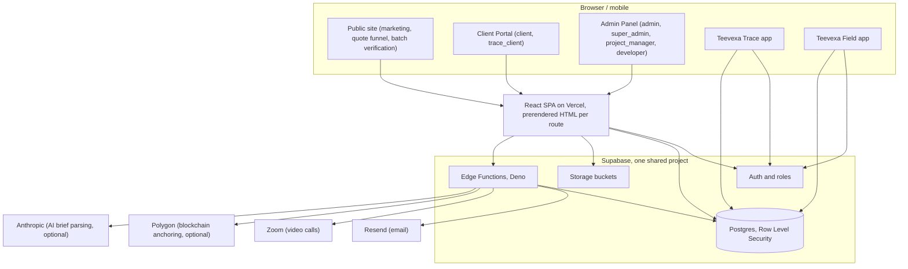

<div align="center">

# Teevexa Web

Marketing site, project-quote funnel, client portal and admin system for Teevexa Ltd, plus the public verification surface for the Teevexa Trace supply-chain product.

[](https://react.dev)
[](https://www.typescriptlang.org)
[](https://vitejs.dev)
[](https://tailwindcss.com)
[](https://supabase.com)
[](#license)

</div>

## Links

- Live site: [www.teevexa.com](https://www.teevexa.com)
- Public batch verification: [www.teevexa.com/verify](https://www.teevexa.com/verify)
- Teevexa Trace API docs: [www.teevexa.com/api-docs](https://www.teevexa.com/api-docs)

The client portal (`/client-portal`) and admin panel (`/admin`) are role-gated and not publicly browsable.

## Overview

Teevexa Ltd is a Nairobi-based software studio. This repository is the company's main web platform: it is how prospective clients describe a project and get a quote, how the team runs client work (proposals, milestones, invoices, deliverables, support), and how buyers of Teevexa Trace verify the supply chain of a physical product by batch ID.

The codebase is a single React single-page application with three gated surfaces sharing one Supabase backend:

- **Public site**: company marketing pages, services, an account-less project quote funnel, consultation booking, the Trace product pages and the public batch-verification pages.
- **Client Portal** (`client`, `trace_client` roles): a client's own projects, proposals, deliverables, invoices, files, messages and Teevexa Trace API keys.
- **Admin Panel** (`admin`, `super_admin`, `project_manager`, `developer` roles): the internal CRM and project-management system the Teevexa team uses to run the business, plus a lightweight CMS for the blog, portfolio and job listings.

The same Supabase project also backs the Teevexa Trace and Teevexa Field mobile apps ([teevexa-trace-dashboard](https://github.com/teevexa/teevexa-trace-dashboard) and [teevexa-trace-field](https://github.com/teevexa/teevexa-trace-field)), so a batch logged in the field app can be verified on this site the same day.

## Key features

| Area | What it does |
| --- | --- |
| Project quote funnel | A visitor describes their project in free text, answers five quick questions, and gets a confirmation that a tailored quote will follow by email within 24 hours. No account is required. Progress is autosaved locally and on the server so a half-finished brief is never lost. |
| AI-assisted intake (optional) | If an Anthropic API key is configured, the free-text description is parsed into a structured brief (project type, capabilities, integrations, timing) and a first-response email draft. Without a key, the same structure is produced by a deterministic keyword matcher, so the funnel works either way. |
| Consultation booking | A 20-minute-slot calendar (three slots per hour, Monday to Saturday, 09:00 to 18:00 Nairobi time with a lunch break) that converts correctly for the visitor's own time zone, blocks double-booking at the database level, and creates a Zoom meeting and calendar invite on confirmation. Booking is gated: a visitor must have already described a project before they can take a slot. |
| Client portal | Projects, milestones and timeline, proposals the client can accept or reject, deliverables with review status, invoices, file sharing, direct messaging with the team, meeting notes and self-service API key management for the Trace API. |
| Admin / internal CRM | Lead pipeline with an AI-drafted first-reply the team reviews and sends, consultation management, a kanban/task/milestone project tracker, time tracking, invoicing, role and team-activity management, and an audit log of sensitive actions. |
| Content CMS | Admin-managed blog posts, portfolio case studies and job postings, each with its own public page and, at build time, its own prerendered HTML and sitemap entry. |
| Teevexa Trace verification | Public, account-less batch lookup by ID (`/verify`, `/trace/:batchId`), a rate-limited REST API for third parties (`batch-verify`), generated PDF certificates and EUDR-style compliance reports, and optional blockchain anchoring of trace events to Polygon. |
| Security model | Postgres row-level security on every table, a seven-role access model, a database trigger that stops anyone but a super admin from granting admin rights, rate-limited public edge functions, scoped storage policies and an audit log. |
| SEO and accessibility | Every public route has a single source of truth for its title, description and structured data, which is rendered to real static HTML at build time (so crawlers and link previews do not depend on JavaScript), plus an auto-generated sitemap, skip links, reduced-motion support and keyboard-accessible components throughout. |

## How it works



The frontend is a Vite-built React SPA deployed to Vercel. Most reads and writes go directly from the browser to Supabase Postgres, protected by row-level security policies rather than an API layer. A set of Deno edge functions handle everything that needs a secret, a third-party call or server-side validation: emailing a quote confirmation, booking a Zoom call, generating a PDF, anchoring a trace event on-chain, or checking whether a visitor has already described a project before letting them book a call.

Notable engineering decisions:

- **Security**: every table has row-level security; the three roles with write access to sensitive data (`admin`, `super_admin`, `project_manager`) are enforced in Postgres policies, not just in the UI, and a dedicated trigger prevents privilege escalation (only a `super_admin` can grant `admin` or `super_admin`).
- **Account-less lead capture**: the quote funnel never requires sign-up. A lead is tracked by a server-issued draft token stored in the browser, not a user account, which keeps the conversion funnel short.
- **Time zone-correct scheduling**: consultation slots are defined once, in Nairobi time, and converted for display in the visitor's own time zone; the booking write path re-validates the slot and relies on a Postgres unique constraint, so a race between two visitors booking the same slot cannot double-book it.
- **Build-time prerendering**: `npm run build` also runs a script that writes real static HTML (title, meta tags, JSON-LD, a no-JS fallback) for every route, including dynamically published blog posts, case studies and jobs, so the SPA is crawlable without running JavaScript.
- **Graceful degradation on optional integrations**: AI brief parsing, Zoom, blockchain anchoring and analytics are all designed to no-op cleanly when their secrets are not configured, rather than failing the request.

## Tech stack

| Layer | Technology |
| --- | --- |
| Frontend | React 18, TypeScript, Vite 5, React Router, TanStack Query, Tailwind CSS, shadcn/ui (Radix primitives), React Hook Form + Zod |
| Backend | Supabase: Postgres with Row Level Security, Auth, Storage, Realtime |
| Serverless | Supabase Edge Functions (Deno, TypeScript) |
| AI | Anthropic API (optional, for brief parsing and reply drafting) |
| Email | Resend |
| Video | Zoom Server-to-Server OAuth |
| Blockchain | Polygon (optional, for trace-event anchoring) |
| Analytics | Plausible (optional, consent-gated) |
| Infrastructure | Vercel (hosting, deploy, headers), Supabase Cloud |
| Tooling | ESLint, Vitest, esbuild (for the build-time scripts) |

## Project structure

```
teevexa-web/
  src/
    pages/            Public pages (About, Services, Start a Project, Pricing, Trace, ...)
    pages/portal/      Client portal pages
    pages/admin/       Admin panel pages
    components/        Shared UI; components/ui is the shadcn/ui primitive library
    components/admin/  Admin layout and navigation
    components/portal/ Portal layout, skeletons and error states
    hooks/             useAuth (roles) and other shared hooks
    lib/                Formatting, audit logging, analytics, markdown rendering
    seo/                Single source of truth for page metadata and JSON-LD builders
    content/            Shared copy (for example FAQ text reused by pages and structured data)
    test/               Vitest unit tests
  supabase/
    migrations/         29 SQL migrations: schema, RLS policies, roles, triggers
    functions/          Deno edge functions (one directory per function)
    functions/_shared/  Code shared across edge functions (slot logic, email/util helpers, pricing)
  scripts/
    generate-sitemap.mjs  Builds public/sitemap.xml from the route table and published content
    prerender.mjs         Writes static HTML per route after the Vite build
  public/               Static assets, icons, robots.txt
```

## Getting started

### Prerequisites

- Node.js 20 or later (developed and tested on Node 22)
- A Supabase project (for local development you can point at a shared development project, or create your own and run the migrations below)
- The [Supabase CLI](https://supabase.com/docs/guides/cli), only needed if you plan to run migrations or deploy edge functions

### Install and run

```bash
git clone git@github.com:teevexa/teevexa-platform.git
cd teevexa-platform
npm install
cp .env.example .env   # fill in the Supabase values described below
npm run dev
```

The app runs at `http://localhost:8080` (configured in `vite.config.ts`).

### Backend setup (optional, only if you need your own Supabase project)

```bash
supabase login
supabase link --project-ref <your-project-ref>
supabase db push                       # applies every migration in supabase/migrations
supabase functions deploy <name>       # deploy one function, or omit the name to deploy all
```

Edge function secrets are set in Supabase, not in `.env` (see the table below for which ones exist and what they do).

## Environment variables

Full documentation with context lives in [`.env.example`](.env.example); the table below is a summary.

| Variable | Where it is set | Required | Purpose |
| --- | --- | --- | --- |
| `VITE_SUPABASE_URL` | `.env`, Vercel | Yes | Supabase project URL, also used at build time to prerender published content |
| `VITE_SUPABASE_PUBLISHABLE_KEY` | `.env`, Vercel | Yes | Supabase anon key (safe to expose; RLS protects the data) |
| `VITE_SUPABASE_PROJECT_ID` | `.env`, Vercel | Yes | Supabase project ref |
| `VITE_PLAUSIBLE_DOMAIN` | `.env`, Vercel | No | Enables consent-gated analytics when set |
| `SUPABASE_DB_PASSWORD` | `.env` (local only) | For CLI use | Needed to run `supabase db push` |
| `RESEND_API_KEY` | Supabase secret | For email | Without it, emails are silently skipped and the UI tells the visitor their message was still saved |
| `CRON_SECRET` | Supabase secret | For scheduled reminders | Shared secret the `automated-reminders` function checks for in an `x-cron-secret` header |
| `ZOOM_ACCOUNT_ID`, `ZOOM_CLIENT_ID`, `ZOOM_CLIENT_SECRET` | Supabase secret | No | Creates a real Zoom meeting on booking; booking still works without them |
| `SITE_URL` | Supabase secret | No | Overrides the default `https://www.teevexa.com` used in email links |
| `ADMIN_NOTIFY_EMAIL` | Supabase secret | No | Inbox for lead, booking and contact alerts |
| `POLYGON_RPC_URL`, `POLYGON_PRIVATE_KEY` | Supabase secret | No | Enables blockchain anchoring of trace events; a safe no-op until both are set |
| `ANTHROPIC_API_KEY`, `ANTHROPIC_MODEL` | Supabase secret | No | Enables AI-assisted brief parsing; deliberately left unset by default to avoid the cost, falling back to a free keyword matcher |

## Scripts

| Command | What it does |
| --- | --- |
| `npm run dev` | Starts the Vite dev server |
| `npm run build` | Generates the sitemap, builds the app, then prerenders static HTML for every route |
| `npm run build:dev` | Same build, in development mode (useful for debugging a production-like build) |
| `npm run preview` | Serves the production build locally |
| `npm run lint` | Runs ESLint |
| `npm test` | Runs the Vitest suite once |
| `npm run test:watch` | Runs Vitest in watch mode |

## Testing

Vitest covers the parts of the codebase with pure, deterministic logic: the quote-estimate engine, the consultation slot and time-zone conversion logic, and the SEO metadata (every public route has a title, description and structured data within length limits, with no duplicates). Run `npm test` to see the current results. There is no end-to-end or UI test suite; those flows are checked manually in a browser during development.

There is no CI workflow configured in this repository: linting, type-checking and tests are run locally before a change is pushed.

## Deployment

The app deploys to Vercel. `vercel.json` sets clean URLs, a 31-536,000-second cache on hashed assets, and baseline security headers (`X-Content-Type-Options`, `Referrer-Policy`, `X-Frame-Options`, `Permissions-Policy`).

To deploy a change that touches the database or edge functions:

1. Set the `VITE_SUPABASE_*` variables in Vercel (Production, Preview and Development) so the build-time prerender step can read published content.
2. Push to the deployed branch; Vercel builds and deploys the frontend automatically.
3. Apply any new migrations: `supabase db push --project-ref <ref>`.
4. Deploy any changed edge functions: `supabase functions deploy <name> --project-ref <ref>`.
5. In Supabase, under Authentication > URL Configuration, the Site URL and redirect URLs must match the deployed domain (`https://www.teevexa.com`).

## Status

| Area | Status |
| --- | --- |
| Public site, quote funnel, booking | Live |
| Client portal, admin panel | Live |
| Teevexa Trace verification pages and API | Live |
| AI-assisted quote parsing | Implemented, off by default (requires `ANTHROPIC_API_KEY`) |
| Zoom meeting creation on booking | Implemented, requires Zoom credentials to be configured |
| Blockchain anchoring of trace events | Implemented, off by default (requires Polygon RPC and wallet credentials) |
| Scheduled reminder emails | Implemented, requires a `pg_cron` job to be scheduled against the `automated-reminders` function |
| Automated CI (lint, typecheck, test on push) | Not yet configured |

## Security

- Every table in the database has row-level security enabled; access is enforced by Postgres policy, not only by the application.
- A database trigger restricts granting the `admin` and `super_admin` roles to existing super admins only.
- Public-facing edge functions apply input validation and per-IP rate limiting.
- Storage buckets use scoped policies (for example, a visitor can only read and write within their own submitted-attachment folder).
- The `SUPABASE_SERVICE_ROLE_KEY`, which bypasses row-level security, is only ever used inside edge functions and is never exposed to the frontend.

There is no published vulnerability-disclosure process for this repository. To report a security issue, email [hello@teevexa.com](mailto:hello@teevexa.com).

## License

Proprietary. All rights reserved. No `LICENSE` file is included and the source is not available for reuse, modification or redistribution without written permission from Teevexa Ltd.

## About

Built by [Teevexa Ltd](https://www.teevexa.com), a software studio based in Nairobi, Kenya, founded by [Benjamin Baya](https://benjaminbaya.com).

Contact: [hello@teevexa.com](mailto:hello@teevexa.com)
